<div align="center">

# 🏢 CorporateOS

### One place for people, projects, approvals and company knowledge.

A full-stack **enterprise operations & workforce management platform** — built from the ground up with
**ASP.NET Core 10** and **React 19**, with real role-based security, approval workflows, reporting and a polished,
responsive UI.


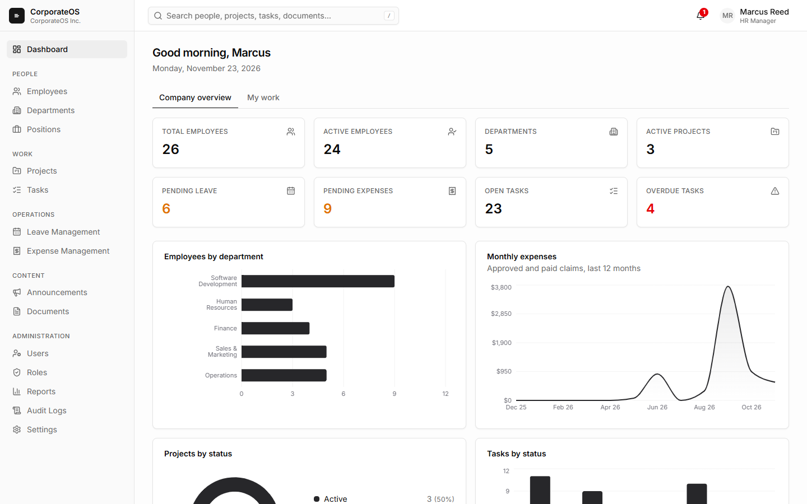

</div>

---

## ✨ Why CorporateOS?

Most companies run their day-to-day on a patchwork of spreadsheets, e-mail threads and chat messages: *Who is on leave
next week? Has my expense been approved? Which tasks are overdue? Who changed this record?* CorporateOS brings all of it
into **one secure, auditable application** where every person sees exactly what their role allows.

| | |
|---|---|
| 👥 **People & organisation** | Employees, departments, positions, managers and reporting lines — with photos, emergency contacts and full history. |
| 📁 **Projects & tasks** | Projects with budgets, members and timelines; tasks on a drag-and-drop Kanban board with comments and due-date reminders. |
| 🌴 **Leave management** | Requests with automatic working-day calculation, yearly balances, overlap protection, a team calendar and one-click approvals. |
| 💳 **Expense management** | Draft → submit → approve/reject → paid, with signature-verified receipts and running totals. |
| 📣 **Company knowledge** | Targeted, scheduled, pinned announcements and a document library with access levels. |
| 📊 **Reports** | Six report types with charts, CSV and Excel export and a print-ready view. |
| 🛡️ **Administration** | Users, roles, lockouts, password resets, system settings and an immutable audit log. |
| 🔔 **Everyday comfort** | Global search (`/`), in-app notifications, e-mail, personal dashboards, mobile-friendly layout. |

### 📈 At a glance

| 116 | 33 | 18 | 147 | 4 |
|:-:|:-:|:-:|:-:|:-:|
| REST endpoints | routed pages | domain entities | automated tests | roles |

---

## 🖼️ Screenshots

<table>
  <tr>
    <td width="50%">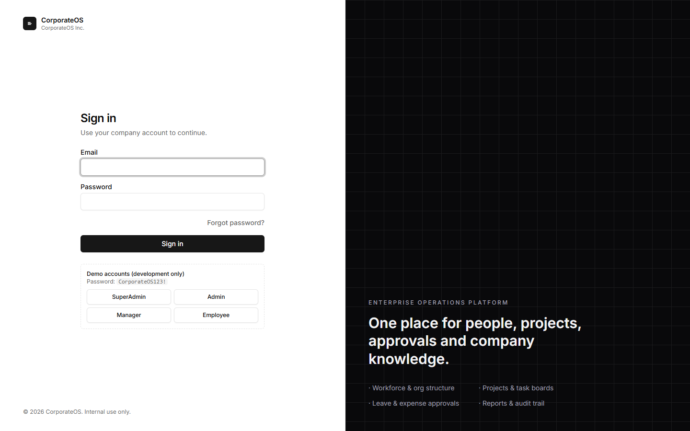<br/><sub><b>Sign-in</b> — demo shortcuts in development</sub></td>
    <td width="50%">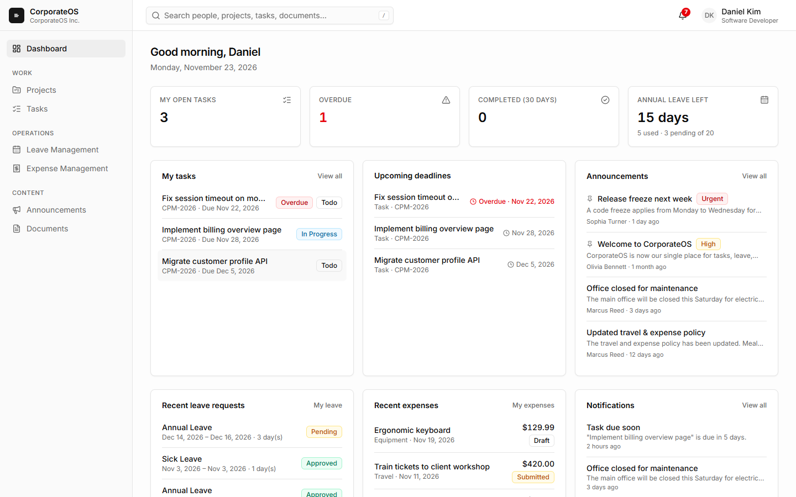<br/><sub><b>Employee dashboard</b> — my tasks, deadlines, leave balance, news</sub></td>
  </tr>
  <tr>
    <td>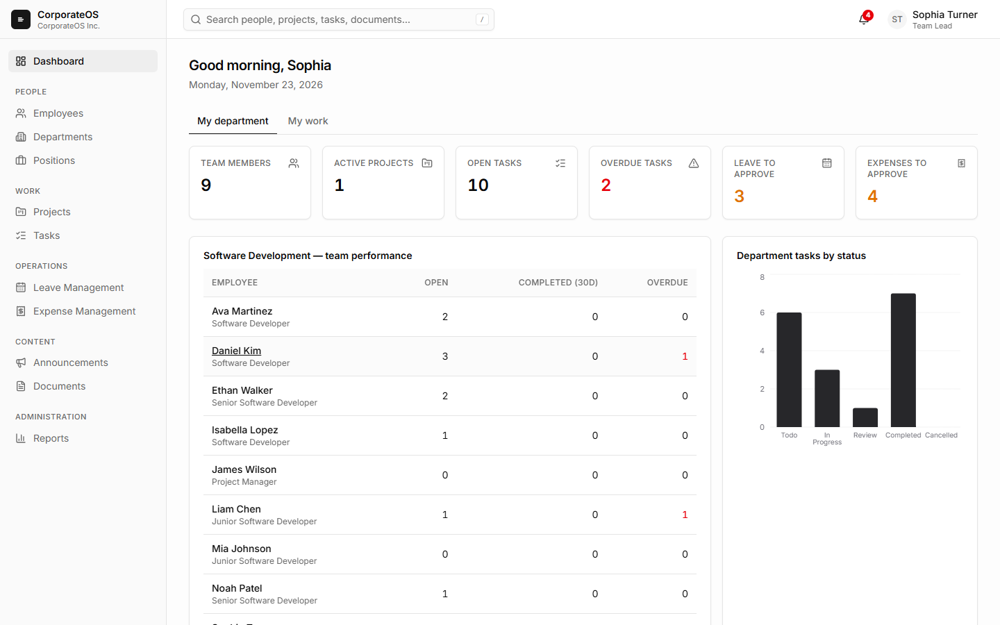<br/><sub><b>Manager dashboard</b> — team performance and pending approvals</sub></td>
    <td>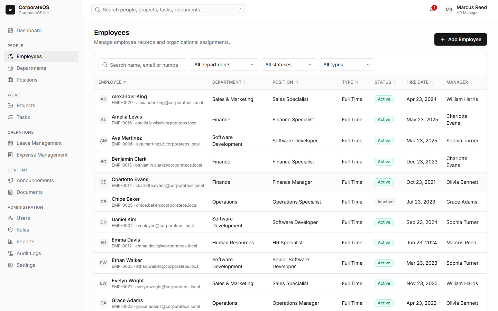<br/><sub><b>Employee directory</b> — search, filters, sorting, paging</sub></td>
  </tr>
  <tr>
    <td>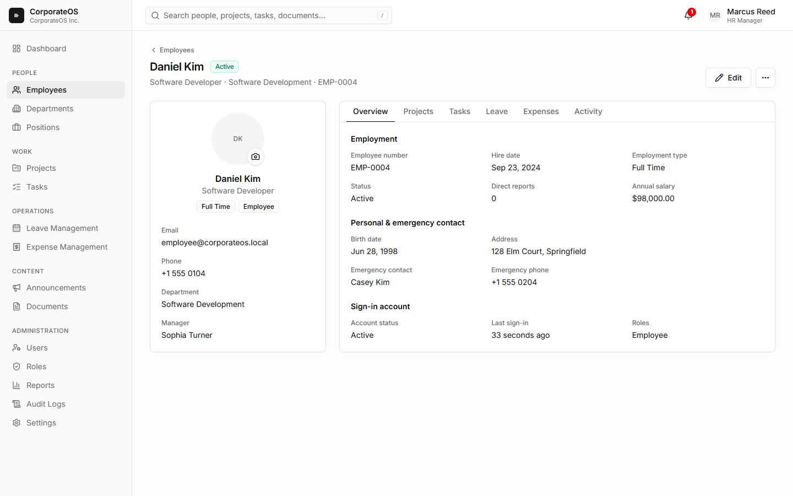<br/><sub><b>Employee profile</b> — employment, contacts, sign-in account, activity</sub></td>
    <td>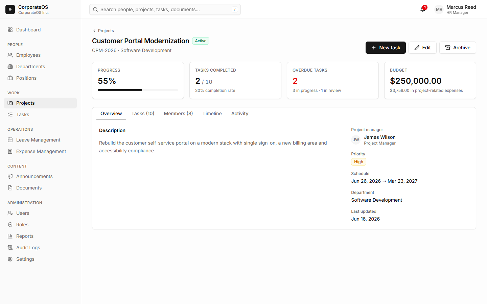<br/><sub><b>Project detail</b> — progress, budget vs. expenses, members, timeline</sub></td>
  </tr>
  <tr>
    <td>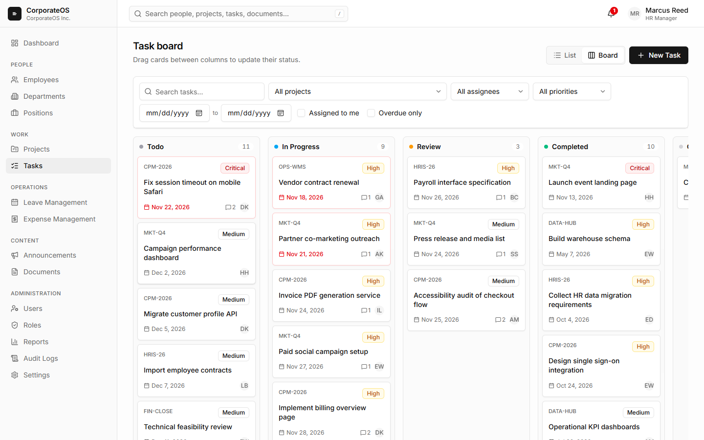<br/><sub><b>Task board</b> — drag cards between columns to change status</sub></td>
    <td>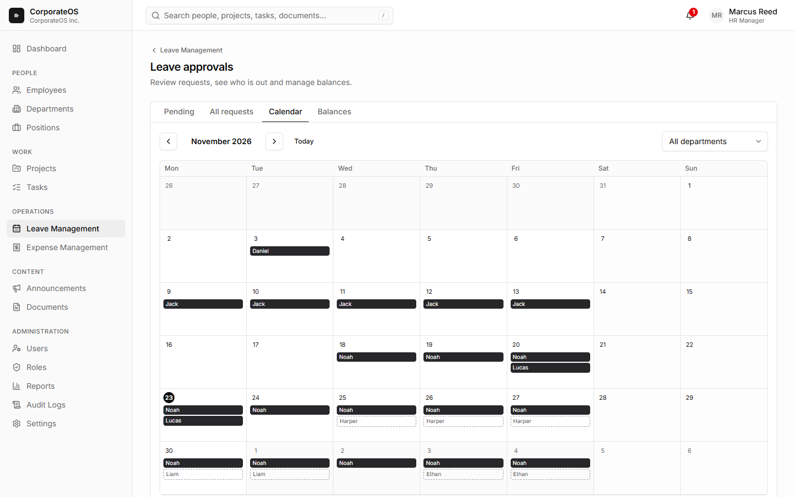<br/><sub><b>Team leave calendar</b> — approved (solid) and pending (dashed)</sub></td>
  </tr>
  <tr>
    <td>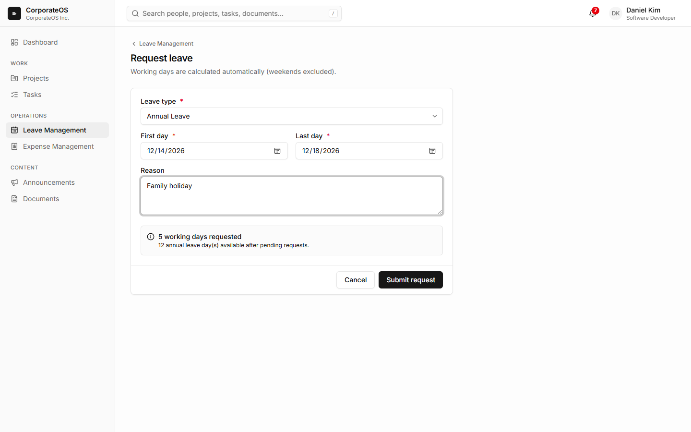<br/><sub><b>Leave request</b> — live working-day count and balance check</sub></td>
    <td>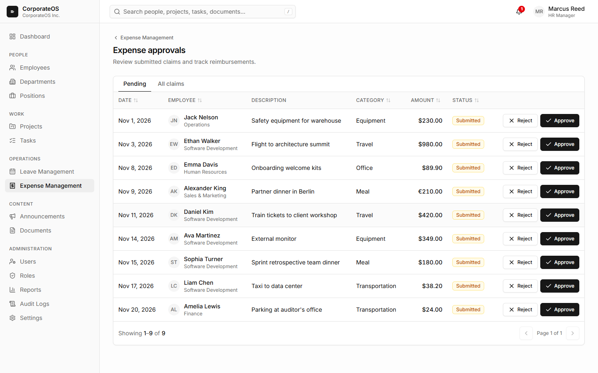<br/><sub><b>Expense approvals</b> — approve or reject with a reason</sub></td>
  </tr>
  <tr>
    <td>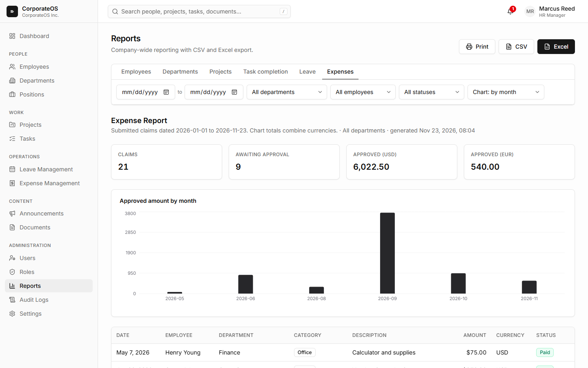<br/><sub><b>Reports</b> — charts plus CSV / Excel export and print</sub></td>
    <td>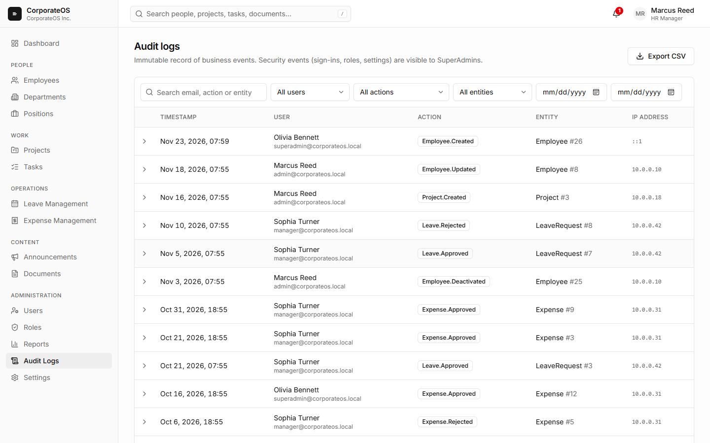<br/><sub><b>Audit log</b> — who did what, when and from where, with before/after values</sub></td>
  </tr>
  <tr>
    <td>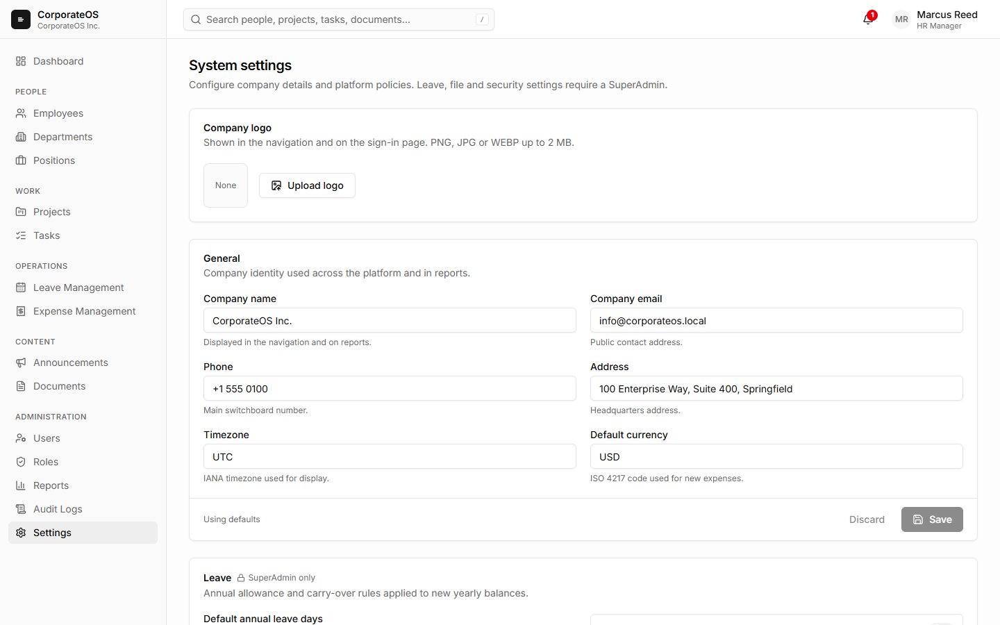<br/><sub><b>System settings</b> — company, leave, file and security policies</sub></td>
    <td align="center">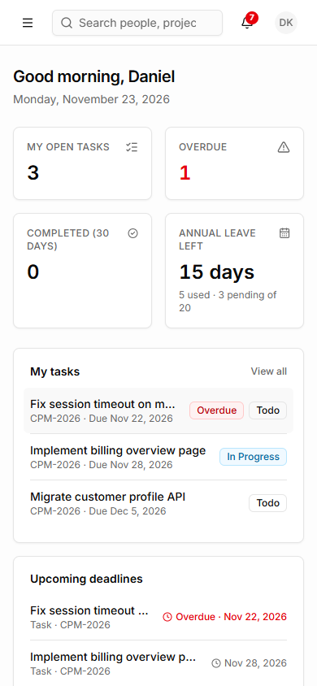<br/><sub><b>Mobile</b> — every page works at phone width</sub></td>
  </tr>
</table>

---

## 🧭 Feature tour

<details open>
<summary><b>📊 Dashboards — a different home page for every role</b></summary>

- **Company overview** (Admin / SuperAdmin): headcount, active projects, pending leave and expenses, open and overdue tasks,
  employees by department, a 12-month expense trend, projects and tasks by status, recent activity, upcoming deadlines.
- **My department** (Manager): a team performance table (open / completed in 30 days / overdue per person), department task
  status chart and everything waiting for the manager's decision.
- **My work** (everyone): my tasks, upcoming deadlines, annual leave left, recent leave and expense requests,
  announcements and notifications.
</details>

<details>
<summary><b>👥 People — employees, departments, positions</b></summary>

- Directory with debounced search, department / status / employment-type filters, sortable columns and server-side paging.
- Rich profile: employment data, manager, direct reports, emergency contact, salary (visible only to authorised roles),
  projects, tasks, leave, expenses and a per-employee activity history.
- Create an employee **and** their sign-in account with a role and temporary password in one step.
- Status changes (active, on leave, inactive, terminated) with safeguards — e.g. a department manager cannot be removed
  until a new manager is assigned.
- Departments with managers and codes; positions with levels from Intern to Executive.
</details>

<details>
<summary><b>📁 Projects & tasks</b></summary>

- Projects with status, priority, schedule, budget, department, project manager and members.
- Budget is visible only to managers and the project manager, and shown next to **project-related expenses**.
- Archive / unarchive; archived projects accept no new tasks.
- Tasks in a list or a **Kanban board** with drag-and-drop status changes, priorities, due dates, estimates,
  actual hours, progress and threaded comments.
- Smart assignment rules: admins and project managers may assign anyone active; department managers may assign their
  department or project members; employees update progress on their own tasks only — and cannot cancel them.
- Overdue highlighting everywhere and automatic **"due soon" reminders** from a background job.
</details>

<details>
<summary><b>🌴 Leave management</b></summary>

- Leave types: annual, sick, unpaid, maternity, paternity and other (reason required).
- Working days calculated on the server (weekends excluded) and previewed live in the form.
- Annual leave is checked against the yearly balance, including days already pending.
- Overlapping requests are rejected; nobody can approve or reject their own request.
- Managers decide for their department, admins for everyone; approval notes and rejection reasons are stored.
- **Team calendar** by month and department, plus a balances view where admins can adjust allowances.
- Employees are notified in-app the moment a decision is made.
</details>

<details>
<summary><b>💳 Expense management</b></summary>

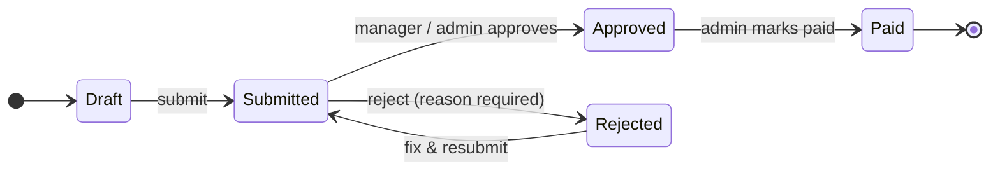

- Categories, multi-currency amounts (two decimals, up to 1,000,000), date window of one year.
- Receipt upload (PDF / PNG / JPG) with **file-signature verification** — a renamed `.exe` is rejected.
- Only drafts and rejected claims are editable; self-approval is impossible by design.
- Personal totals for draft, submitted, approved and paid amounts.
</details>

<details>
<summary><b>📣 Announcements & documents</b></summary>

- Announcements targeted at everyone or a single department, with priority, pinning, a scheduled publish date and expiry.
  Scheduled announcements notify their audience when they go live.
- Document library with categories and access levels (everyone, department only, managers, admins); downloads are checked
  on every request.
</details>

<details>
<summary><b>📊 Reports & exports</b></summary>

Employees · Departments · Projects · Task completion · Leave · Expenses — each with filters, summary cards, a chart,
a detailed table and **CSV / Excel (ClosedXML) export** or a print-friendly layout.
</details>

<details>
<summary><b>🛡️ Administration</b></summary>

- **Users:** activate / deactivate, lock / unlock, reset passwords, assign roles, view sign-in activity.
- **Roles:** permission matrix showing what each role can do.
- **Audit log:** every business event and security event (sign-ins, failed logins, token reuse, role and setting changes)
  with user, IP address and before/after values; filterable and exportable to CSV.
- **Settings:** company name, logo, contact data, timezone and currency; leave allowance and carry-over; upload limits and
  allowed extensions; password policy, lockout and token lifetimes — applied at runtime without a redeploy.
</details>

---

## 🏗️ Architecture

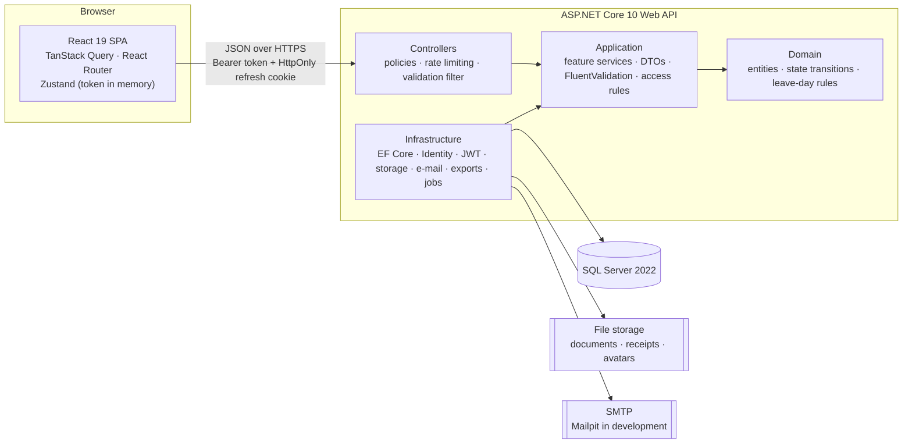

**Clean architecture** keeps the business rules independent of frameworks:

- **Domain** — entities and invariants (`LeaveRequest.Approve`, `Expense.Submit`, `TaskItem.ChangeStatus`,
  `LeaveDayCalculator`). Rule violations raise a `DomainException` → HTTP `422`.
- **Application** — one service per feature, request/response DTOs, FluentValidation validators and a single source of
  truth for visibility (`ProjectAccess`, department scopes).
- **Infrastructure** — EF Core with string-stored enums, soft delete, audit interceptor, Identity, token service, local file
  storage, SMTP, Excel/CSV export, settings cache, demo seeder and scheduled jobs.
- **API** — thin controllers, policy-based authorization, a global exception handler and one response envelope:

```json
{ "success": false, "data": null, "message": "Validation failed", "errors": { "endDate": ["End date cannot be earlier than start date."] } }
```

| Status | Meaning |
|---|---|
| `400` | Validation failed — per-field messages shown inline in the forms |
| `401` / `403` | Not signed in / not allowed |
| `404` | Not found |
| `409` | Conflict — duplicate e-mail, overlapping leave, concurrent edit |
| `422` | Business rule — e.g. approving a request that is no longer pending |

### Frontend

- **React 19 + TypeScript** with Vite, **Tailwind CSS 4** and Radix UI primitives for accessible dialogs, menus and tabs.
- **TanStack Query** for server state and caching, **React Hook Form + Zod** for forms that mirror the server rules,
  **Recharts** for charts, **sonner** toasts.
- Route guards per role, a silent token refresh in the axios client and session restore on reload.
- Server-side validation errors are mapped back onto the matching form fields.

---

## 🔐 Security, done properly

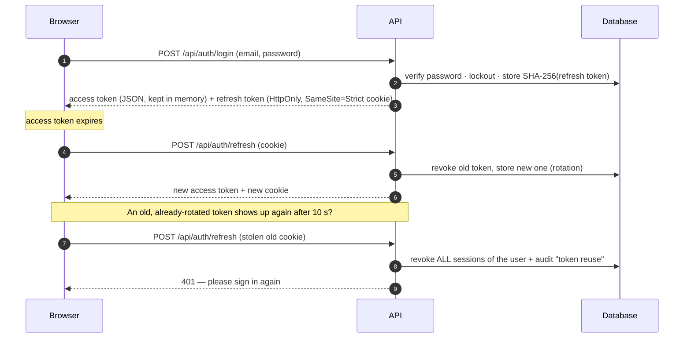

- 🔑 Passwords hashed by ASP.NET Core Identity; configurable password policy and **account lockout**.
- 🎟️ Short-lived JWTs kept **only in memory** — never in `localStorage`.
- 🍪 Refresh tokens are random, stored as **SHA-256 hashes**, sent only in an **HttpOnly, SameSite=Strict** cookie and
  **rotated on every use**. Reuse of a rotated token outside a 10-second race window is treated as theft and revokes
  every session of the user.
- 🚦 **Rate limiting** on authentication endpoints; the same generic message for a wrong e-mail or a wrong password.
- 🧾 Uploads: extension allow-list, hard block-list, size limits and **magic-byte signature checks**.
- 🧱 Authorization enforced on the server for every request — the UI only hides what the API would refuse anyway.
- 📜 **Audit trail** for business and security events; internal error details only in Development.
- 🧰 Security headers, strict CORS, HSTS and HTTPS redirection outside Development; no secrets in the repository.

### Roles and permissions

| Capability | Employee | Manager | Admin | SuperAdmin |
|---|:-:|:-:|:-:|:-:|
| Own profile, tasks, leave, expenses, announcements, documents | ✅ | ✅ | ✅ | ✅ |
| Read employees, departments, positions | | ✅ | ✅ | ✅ |
| Approve leave and expenses | | own department | ✅ all | ✅ all |
| Create and assign tasks | as project manager | department & project members | ✅ | ✅ |
| Reports and exports | | ✅ | ✅ | ✅ |
| Create / edit employees, projects, departments | | | ✅ | ✅ |
| Users, roles, audit log, general settings | | | ✅ | ✅ |
| Grant Admin / SuperAdmin, security · leave · file settings, security audit events | | | | ✅ |

---

## 🚀 Getting started

### Prerequisites

- [.NET SDK 10](https://dotnet.microsoft.com/download) (10.0.404+)
- [Node.js](https://nodejs.org/) 20.19+ or 22.12+ (required by Vite 8)
- [Docker Desktop](https://www.docker.com/products/docker-desktop/) — SQL Server, Mailpit and the integration tests
- Optional: `dotnet tool install --global dotnet-ef`

### 1 · Configure

```powershell
git clone https://github.com/eerdoganhsn/CorporateOS.git
cd CorporateOS
Copy-Item .env.example .env          # bash: cp .env.example .env
```

Set a strong `MSSQL_SA_PASSWORD` (also inside `ConnectionStrings__DefaultConnection`) and a random `Jwt__Key` (≥ 32 chars):

```powershell
[Convert]::ToBase64String([Security.Cryptography.RandomNumberGenerator]::GetBytes(48))   # PowerShell 7+
```

### 2 · Start the infrastructure

```powershell
docker compose up -d        # SQL Server 2022 + Mailpit
```

### 3 · Run the API

```powershell
cd backend
dotnet run --project src/CorporateOS.API --launch-profile http
```

On first start in Development the API applies migrations and seeds a realistic demo company.

| Service | URL |
|---|---|
| API / health | http://localhost:5000 · `/health` |
| Swagger UI | http://localhost:5000/swagger |
| Mailpit (password-reset e-mails) | http://localhost:8025 |

### 4 · Run the frontend

```powershell
cd frontend
npm install
Copy-Item .env.example .env
npm run dev                  # http://localhost:5173
```

> [!NOTE]
> **Path containing `#`?** Vite's dev server cannot serve a project whose path contains `#` (e.g. `C:\...\C#\CorporateOS`) —
> the page stays blank and `/@vite/client` returns 404. `npm run build` / `npm run preview` are unaffected. Either move the
> repository, or run dev mode through a junction:
>
> ```powershell
> New-Item -ItemType Junction -Path C:\dev\CorporateOS -Target "<repository path>"   # once
> cd C:\dev\CorporateOS\frontend
> npm run dev:link
> ```
>
> `dev:link` starts Vite with Node's `--preserve-symlinks` flags; together with `resolve.preserveSymlinks` in
> `vite.config.ts` every path stays on the junction.

### 🔑 Demo accounts

Seeded in Development only — password for all: **`CorporateOS123!`**

| Role | E-mail | Who |
|---|---|---|
| SuperAdmin | `superadmin@corporateos.local` | Olivia Bennett — CEO |
| Admin | `admin@corporateos.local` | Marcus Reed — HR Manager |
| Manager | `manager@corporateos.local` | Sophia Turner — Team Lead, Software Development |
| Employee | `employee@corporateos.local` | Daniel Kim — Software Developer, reports to Sophia |

The seed creates a believable company: **25 employees in 5 departments, 6 projects** with tasks and comments, leave
requests and balances, expenses in every state, announcements, documents, notifications and audit history.
The sign-in page offers one-click buttons for these accounts in `npm run dev`, and in builds only when
`VITE_SHOW_DEMO_ACCOUNTS=true` (set in the local `frontend/.env` — never in production).

---

## 🧪 Quality & testing

```powershell
cd backend
dotnet test                  # 99 unit + 48 integration tests
```

| Suite | What it proves |
|---|---|
| **Unit — 99 tests** (xUnit, FluentAssertions, EF Core InMemory, `FakeTimeProvider`) | Validators for employees, projects, tasks, leave and expenses · working-day calculation · leave / expense / task state transitions · file-signature checks · task authorization (who may assign, edit, cancel) |
| **Integration — 48 tests** (`WebApplicationFactory` + **Testcontainers SQL Server**) | Real HTTP against a real database: login, unauthorized access, refresh rotation, **token-reuse detection** (with a controllable clock), role gates, and the employee, project, leave and expense workflows end to end |
| **Browser — Playwright** (`scripts/dev-checks/check.mjs`) | Signs in as every role through the UI, visits every route, checks forbidden redirects, session restore after reload, an employee → manager leave approval and phone-width layout on 15 pages |
| **Static** | `dotnet build` with **0 warnings**, TypeScript strict mode, ESLint + Prettier |

```powershell
cd frontend; npm run lint; npm run build
# Browser check (API on :5000, built frontend on :5173):
npx vite preview --port 5173
cd ../scripts/dev-checks; npm install; npm run check      # → TOTAL PROBLEMS: 0
node screenshots.mjs                                      # regenerates docs/screenshots
```

---

## ⚙️ Configuration

Settings come from `appsettings.json`, `appsettings.{Environment}.json`, environment variables (`Section__Key`) and, in
Development only, the repository `.env` file. Real environment variables always win.

| Key | Purpose | Default |
|---|---|---|
| `ConnectionStrings:DefaultConnection` | SQL Server connection | required |
| `Jwt:Key` / `Issuer` / `Audience` | Access-token signing | key required, ≥ 32 chars |
| `AuthCookie:Name` / `Path` / `Secure` | Refresh-token cookie | `corporateos_rt`, `/api/auth`, `true` (`false` in Development) |
| `App:FrontendUrl`, `Cors:AllowedOrigins` | Links in e-mails, CORS | `http://localhost:5173` |
| `Database:ApplyMigrationsOnStartup` / `SeedDemoData` | Startup migration and demo seed | `false` (`true` in Development) |
| `Storage:RootPath` | Uploaded files | `App_Data/uploads` |
| `Smtp:*` | Outgoing e-mail; an empty host disables sending | Mailpit in Development |
| `RateLimiting:AuthPermitLimit` | Auth requests per minute per IP | `10` (`100` in Development) |
| `ScheduledJobs:Enabled` / `IntervalMinutes` | Reminders, scheduled announcements, token cleanup | `true`, `15` |
| `Swagger:Enabled` | Swagger UI | `false` (`true` in Development) |
| `VITE_API_URL` (frontend) | API base URL including `/api` | `http://localhost:5000/api` |
| `VITE_SHOW_DEMO_ACCOUNTS` (frontend) | Demo sign-in shortcuts in builds | off (always on in `npm run dev`) |

Runtime policies (company details, leave allowance, upload limits, password and lockout rules, token lifetimes) live in
**Admin → Settings**; leave, file and security settings require a SuperAdmin.

---

## 📂 Project structure

```
CorporateOS/
├── backend/
│   ├── src/
│   │   ├── CorporateOS.Domain/          entities, enums, domain rules
│   │   ├── CorporateOS.Application/     feature services, DTOs, validators, access rules
│   │   ├── CorporateOS.Infrastructure/  EF Core + migrations, Identity, JWT, storage, e-mail, exports, jobs, seed
│   │   └── CorporateOS.API/             controllers, auth, policies, middleware, Swagger
│   └── tests/
│       ├── CorporateOS.UnitTests/
│       └── CorporateOS.IntegrationTests/
├── frontend/
│   └── src/
│       ├── api/          axios client with silent refresh, typed endpoints
│       ├── components/   UI primitives, data tables, forms, charts, states
│       ├── features/     feature components (dashboards, tasks, leave, …)
│       ├── pages/        33 routed pages
│       └── routes/       router and role guards
├── scripts/dev-checks/   API smoke/flow scripts, Playwright browser check, screenshot generator
├── docs/screenshots/     images used in this README
├── docker-compose.yml    SQL Server + Mailpit
└── .env.example          local configuration template
```

---

## 🗄️ Database

Migrations live in `backend/src/CorporateOS.Infrastructure/Persistence/Migrations`.

```powershell
cd backend
dotnet build
dotnet ef migrations add <Name> --project src/CorporateOS.Infrastructure --startup-project src/CorporateOS.API
```

Reset to a fresh demo company:

```powershell
cd backend
dotnet ef database drop --force --project src/CorporateOS.Infrastructure --startup-project src/CorporateOS.API
Remove-Item -Recurse -Force src/CorporateOS.API/App_Data -ErrorAction SilentlyContinue
dotnet run --project src/CorporateOS.API --launch-profile http     # migrates and seeds again
```

---

## 🧩 Known limitations

- Leave days count Monday–Friday; public holidays are not modelled yet.
- Expense totals are per currency; there is no currency conversion.
- Files live on the local disk — use shared storage when running several API instances.
- Scheduled jobs run inside the API process; with several instances enable them on one only.
- Vite's dev server cannot run from a path containing `#` (see [Getting started](#4--run-the-frontend)).

## 🛠️ Troubleshooting

| Symptom | Fix |
|---|---|
| Blank page in `npm run dev`, `/@vite/client` 404 | The path contains `#` — use `npm run dev:link` from a junction, or `npm run build && npm run preview` |
| API stops at startup: connection string or JWT key missing | Create `.env` from `.env.example`, or set the environment variables |
| `docker compose up` port conflict | Change `MSSQL_PORT` / `MAILPIT_*` in `.env` (keep `Smtp__Port` equal to `MAILPIT_SMTP_PORT`) |
| Sign-in returns `429` | Auth rate limit reached — wait a minute or raise `RateLimiting:AuthPermitLimit` locally |
| Integration tests do not start | Start Docker; the first run downloads the SQL Server image |
| New migration not picked up with `--no-build` | Build first; `dotnet ef` reads the compiled assembly |

---

<div align="center">

Built with ☕, **C#** and **TypeScript**.

</div>
